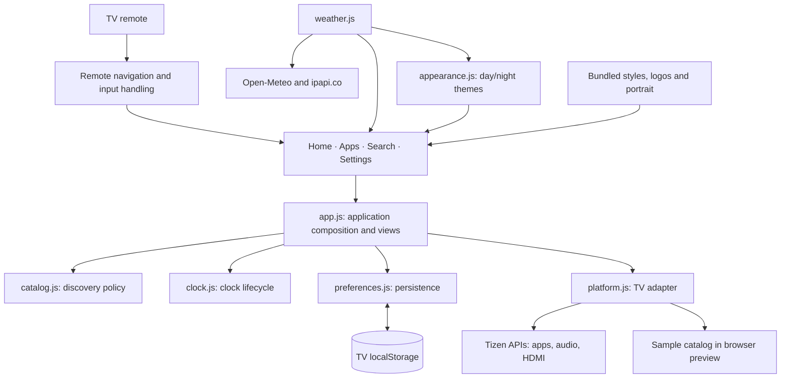

# Still · Samsung TV dashboard

A personal, remote-friendly home screen for Samsung Tizen TVs. Still brings favorite apps, local weather, a clock, and TV controls into a calm interface built with plain HTML, CSS, and JavaScript.

**Current version: 1.9.36** · Installed and launched on a Samsung QN65S85FAFXZC · Tizen 6.0+ required by the manifest

## Screenshots

Browser previews in Obsidian mode at 1920 × 1080. App inventory is sample data; the Home capture shows live Toronto weather. These are interface previews, not photographs of the TV.


## Features

- Home screen with a personal portrait, clock, reminder, and favorite apps.
- App discovery, search, launch, and favorite ordering on the TV.
- Remote arrow navigation with eased horizontal scrolling and selection zoom.
- Edit mode to pin, reorder, and hide apps from Home and search.
- Light and dark themes, automatic day/night appearance, and reduced-motion support.
- Local weather, city search, weather scenes, and sunrise/sunset appearance timing.
- HDMI selection, volume/mute controls, and shortcuts to native TV panels where supported.
- Preferences saved locally on the TV.

## Architecture

The installed app runs directly on the TV. Its UI assets are bundled in the signed widget; a Mac server is not required at runtime. Internet access supplies weather and location data.



- **Application:** `app.js` composes views, search, and editing; `catalog.js` owns discovery rules, `preferences.js` owns saved settings, and `clock.js` owns clock updates. Hidden views render lazily; unchanged discovery results preserve focus and shelf position.
- **Platform:** `platform.js` wraps public Tizen application, audio, system information, and TV window APIs. It supplies sample app entries when running in a desktop browser.
- **Navigation:** `remote.js` normalizes Samsung keys, handles native text editing, and reveals focused items. `spatial-focus.js` selects directional focus targets. `navigation.js` animates the top navigation selection; `focus.js` contains a separate focus-frame implementation and is currently not loaded by the entry page.
- **Presentation:** `style.css`, `logos.js`, and `layout.js` provide themes, app artwork, focus treatments, and viewport sizing.
- **Weather:** `weather.js` handles location, forecasts, cached data, and weather scenes; `appearance.js` selects manual or automatic themes.

See [module boundaries and extension guidance](docs/architecture.md) for the architecture and public interfaces.

## Run a browser preview

Requires Python 3. Run from the repository root:

```sh
python3 scripts/start.py preview
```

Open [localhost:8766](http://localhost:8766). Use arrow keys to navigate and Enter to select. TV app launch, HDMI, and audio controls require the installed TV app.

## Test

Requires Node.js with the built-in test runner. No npm install is needed for the regression suite.

```sh
node --test dashboard/tests/*.test.cjs
```

The current suite contains 66 tests covering app discovery, edit mode, remote/IME input, scrolling, audio, HDMI, themes, weather, artwork, and rendering behavior. Optional browser weather checks in `dashboard/tools/check-weather.cjs` additionally require Playwright and Chrome.

## Install on a Samsung TV

1. Install Tizen Studio, Samsung TV extensions, and Samsung certificate tools.
2. Enable Developer Mode on the TV and configure the development computer address.
3. Create a signing profile with a distributor certificate that includes your TV's DUID.
4. Package `dashboard/tizen/` as a signed `.wgt`, connect to the TV with SDB, and install it with your Samsung TV tooling.
5. Launch application `StillHome1.Dashboard` (package `StillHome1`).

This repository excludes the SDK, signed packages, signing certificates, and pairing credentials. Existing-device updates used Samsung's direct `vd_appinstall` path; the SDK's `tz install` previously uninstalled/reinstalled the app and reset its local data. See the [device notes and release history](dashboard/tizen/README.md) for the project's tested setup and limitations.

## Use Still as your startup app

Install the signed widget first using the steps above. Python 3 and Samsung's Tizen tools are needed for the launch script; no Python packages are required.

### 1. Launch Still with the script

Turn the TV on, connect the computer and TV to the same network, and enable Developer Mode with your computer's current IP address. From the repository root, run:

```sh
python3 scripts/start.py tv --host 10.0.0.4
```

Replace `10.0.0.4` with your TV's IP address (available under its network settings). The script connects over SDB and launches the installed `StillHome1` package. It finds `sdb` and `tz` on PATH, then checks this project's `.tools/tizen-studio/` installation. For a different SDK location:

```sh
python3 scripts/start.py tv --host 192.168.1.50 \
  --sdb /absolute/path/tizen-studio/tools/sdb \
  --tz /absolute/path/tizen-studio/tools/tizen-core/tz
```

This command launches Still once. It does not install the widget, wake the TV, or configure power-on behavior. Run `python3 scripts/start.py --help` for commands, or append `--help` to `tv` or `preview` for options. The script works from other directories when invoked by its absolute path.

### 2. Enable the TV's startup setting

On TVs that offer it:

1. Open **Settings → All Settings → General & Privacy → Start Screen Options**. Some newer models put this under **Advanced Features**; older ones use **General → Smart Features**.
2. Enable **Autorun Last App** and disable **Start with Smart Hub Home / Autorun Smart Hub** if it overrides your selection.
3. Open Still again, using the script or its app icon. Leave Still on screen, turn the TV off with the remote, then turn it on again.
4. Confirm that Still appears. Repeat after using another app: return to Still before switching off if you want it to be the last-used app.

Samsung documents these settings in its [Start Screen Options guide](https://www.samsung.com/au/support/tv-audio-video/use-autorun-start-screen-options-on-your-samsung-tv/). Availability and app eligibility vary by model and firmware. Autorun Last App does not permanently assign Still as the system launcher; automatic startup for this developer-installed widget needs verification on your TV. If the option is absent or Still does not resume, launch it manually with the script or app icon. Once running on the TV, Still does not need the computer to remain on.

### Existing experimental startup setup

The development TV also has a separate, model-specific native Home/startup configuration, described in the [device notes](dashboard/tizen/README.md#native-startup-configuration). Its saved original settings and recovery utility are outside this repository. That procedure is not a portable setup script, and real power-off/on confirmation is still pending. Preserve that recovery folder when using the existing development setup. To undo that setup on the original development machine:

```sh
python3 /Users/namakibiswas/Documents/ChatGPT/still-tv-recovery/run.py restore
```

For the standard TV-menu setup above, turn off Autorun Last App and re-enable Smart Hub Home to return to Samsung's usual startup screen.

## Repository layout

```text
 dashboard/
   tizen/          Current native TV app and bundled assets
   tests/          Node.js regression tests
   tools/          Weather assets and browser verification tools
   weather-check/  Weather verification results
   dist/           Earlier browser dashboard
   server.py       Optional legacy Python remote bridge
 docs/screenshots/ Current browser preview captures
 samsung_tv.py     Optional legacy TV pairing/remote client
```

The earlier server in `dashboard/server.py` serves `dashboard/dist/`, not the current Tizen UI. Its pairing token stays in the ignored `.tv-connection.json` file.

## Artwork and customization

The welcome names and portrait are personalized in `dashboard/tizen/index.html` and `dashboard/tizen/images/home-portrait.png`. App artwork provenance is documented in [SOURCES.md](dashboard/tizen/icons/official/SOURCES.md). Third-party names and logos belong to their respective owners.

## License

Original source code and documentation are licensed under the [MIT License](LICENSE), copyright © 2026 Namaki Biswas. The following materials are excluded from that MIT grant:

- **Third-party code:** SunCalc retains its [BSD 2-Clause license](dashboard/tizen/vendor/SunCalc-LICENSE). Preserve its license and copyright notices when redistributing it.
- **Third-party artwork and branding:** App icons, logos, and trademarks remain subject to their owners' rights and applicable terms. See the [artwork sources](dashboard/tizen/icons/official/SOURCES.md). Inclusion in this repository does not grant additional rights to use or redistribute them or imply endorsement.
- **Third-party image assets:** The NASA lunar map retains its original usage terms and credits; see the [image sources](dashboard/tizen/images/SOURCES.md).
- **Personal images:** The personalized `dashboard/tizen/images/home-portrait.png` and its depiction in screenshots are not licensed for reuse. Replace them with your own images when adapting Still.
